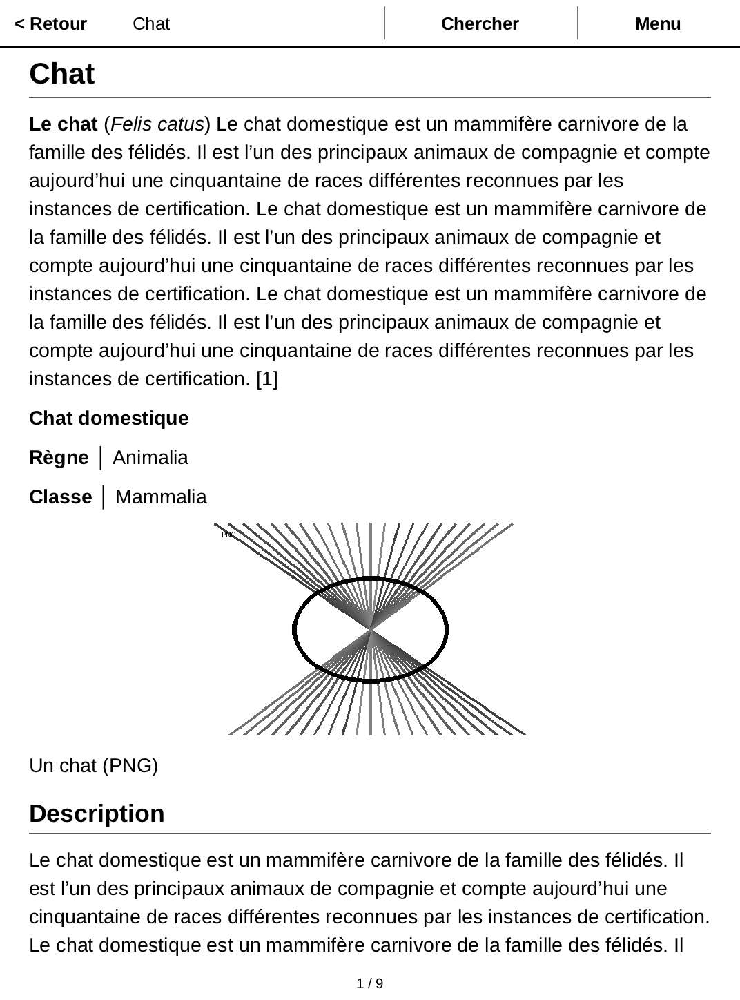

# Lecteur ZIM pour PocketBook

Application native pour lire des archives **ZIM** (Wikipédia hors-ligne, Wiktionnaire,
Wikivoyage, etc. — voir <https://library.kiwix.org>) directement sur une liseuse PocketBook.



Contrairement à [Pocketbook-ZIM-Reader](https://github.com/JuanJakobo/Pocketbook-ZIM-Reader),
elle n'utilise ni libzim, ni Xapian, ni ICU : le format ZIM est lu par un petit lecteur
maison et les articles sont affichés par l'application elle-même. Le binaire ne dépend
que de `libinkview` (fournie par le firmware) et de la libc.

## Fonctions

- liste automatique des fichiers `.zim` de la mémoire interne et de la carte SD ;
- affichage paginé des articles : titres, gras/italique, listes, tableaux (linéarisés),
  code, images JPEG / PNG / GIF / WebP en niveaux de gris ;
- liens entre articles cliquables, historique (« Retour »), redirections ;
- recherche par **début de titre**, article au hasard, page d'accueil du ZIM ;
- taille du texte réglable, reprise au dernier article lu ;
- ZIM v5 et v6, clusters zstd / xz / non compressés, archives découpées
  (`.zimaa`, `.zimab`, …) pour passer la limite FAT32 de 4 Go.

## Installation

1. Brancher la liseuse en USB.
2. Copier [`dist/ZIMReader.app`](dist/ZIMReader.app) dans le dossier `applications/` de la liseuse.
3. Copier un ou plusieurs fichiers `.zim` n'importe où sur la liseuse (par ex. un dossier `ZIM/`).
4. Éjecter, puis lancer **ZIMReader** depuis le menu Applications.

> La mémoire des PocketBook est en FAT32 : un fichier ne peut pas dépasser 4 Go.
> Pour un ZIM plus gros : `zimsplit --size 2000000000 gros.zim` (paquet `zim-tools`),
> puis copier tous les morceaux `.zimaa`, `.zimab`, … dans le même dossier.

## Utilisation

| Geste | Effet |
|---|---|
| toucher la droite de la page / glisser vers la gauche / bouton page suivante | page suivante |
| toucher le tiers gauche / glisser vers la droite / bouton page précédente | page précédente |
| toucher un texte souligné | suivre le lien |
| `< Retour` (ou bouton retour) | article précédent |
| `Chercher` | recherche par début de titre |
| `Menu` (ou bouton menu) | accueil, hasard, changer de fichier, taille du texte, quitter |

## État du projet

Testé sur PC et en émulation ARM (qemu) avec le compilateur du SDK PocketBook : lecture
ZIM, mise en page, images, recherche, archives de plus de 4 Go découpées.
**La partie écran/tactile (inkview) n'a pas encore été validée sur une vraie liseuse.**
Cible : PocketBook Verse (PB629, écran 758 × 1024, avec carte microSD) ; devrait fonctionner
sur les autres modèles tactiles au firmware 6.x (la mise en page s'adapte à la taille d'écran).

Limites connues : pas de recherche plein texte ni de tolérance aux accents manquants,
pas de formules mathématiques (le source LaTeX est affiché), tableaux affichés ligne par ligne.

## Compilation

```bash
git clone --depth 1 -b 6.5 https://github.com/pocketbook/SDK_6.3.0
PB_SDK=$PWD/SDK_6.3.0/SDK-B288 ./build.sh      # -> build/pb/ZIMReader.app
```

Banc de test sur PC (rend les pages en PNG, sans SDK) :

```bash
pip install libzim pillow
./host/build.sh
python3 test/make_test_zim.py /tmp/zims/test.zim
./build/host/host_test /tmp/out /tmp/zims href:open:/tmp/zims/test.zim link:0 shot next shot
```

## Organisation

- `src/zim.*` lecteur d'archives ZIM · `src/html.*` HTML → modèle de document ·
  `src/layout.*` pagination · `src/image.*` décodage d'images · `src/app.*` navigation ·
  `src/pb_main.cpp` couche PocketBook (inkview)
- `host/` banc de test PC · `test/` générateurs de ZIM de test
- `third_party/` : zstd (BSD), libwebp (BSD), stb (domaine public / MIT)
